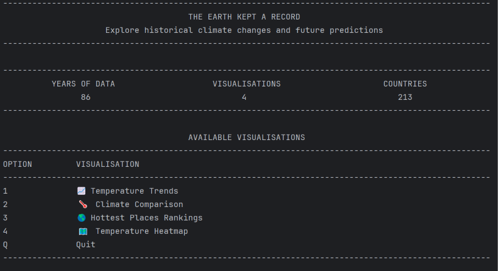
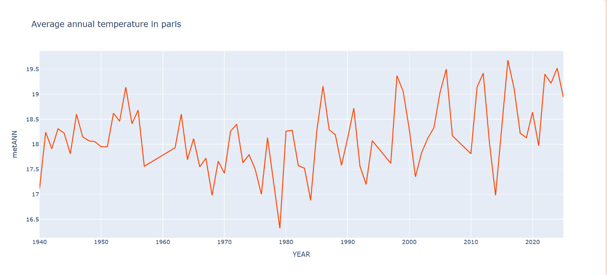
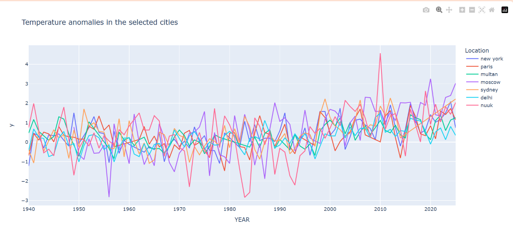
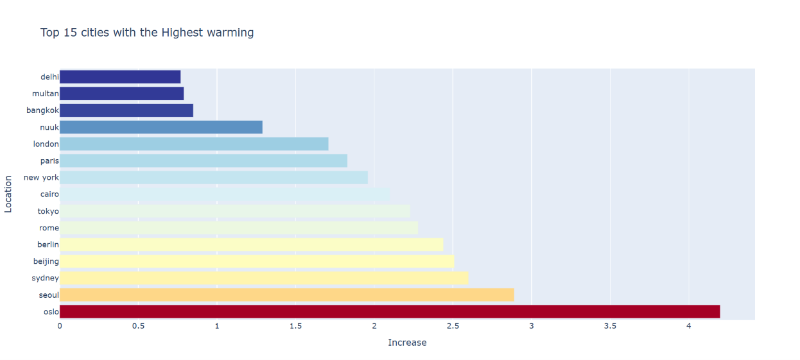
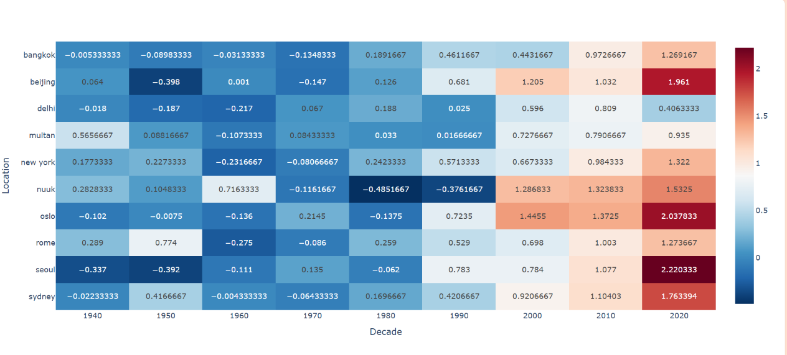

# 🌍 The Earth Kept a Record. Here It Is.

### 80+ Years of Climate Change Through Interactive Visualizations

### **-- IMP note I like to use emojis and they are not AI so please enjoy the README --**

---
# What the project really is in some precise bulleted points️
(nobody like paragraphs anyways)
- The Earth Kept a Record. Here It Is.
- It is CLI based project.
- Using over 80 years of real-world temperature data, 
- users can explore climate trends through four interactive visualisations, compare cities and countries, 
- view temperature rankings, explore decade-based heatmaps. 
- The goal of the project is to make climate data simple, engaging, and easy to understand for everyone. 
- be sure to follow the instructions given in the CLI program
- *May the odds ever be in your favor*

---
---
# How to set up and use the program
Inorder to set up and use this ClI program.

Kindly follow this steps.

1. Go to the assets of this github repo or you could be on it already
  "https://github.com/ShehmaAli/The-Earth-kept-a-record.-Here-it-is..."
2. download the executable program file and the data along with it
  IMP Note: Be sure to keep the data and the executable file in the same folder to it to work or otherwise it might be a headache to set up
3. when you have downloaded and set up the program THEN HIT RUN (do not literary run I meant the run button)
4. you we see a interface like this
  

### To USE the program finally!!!!
1. In the homepage.
2. Choose a graph.
3. Select City or Country.
4. Interact with the controls.
5. Explore the results.

#### _As simple as that_
---

# THE visualisations in this program as images of them (No paragraphs as well)

## There are 4 in total just look at them to really know what each is like

### 📈Temperature trends

### 🌡️ Climate Comparison

### 🌎 Hottest Places Rankings

### 🗺️ Temperature Heatmap

# Some things to keep in mind when going through the program 

## What is a Temperature Anomaly? 

A temperature anomaly shows how much warmer or cooler a place is compared to its usual long-term average temperature.
Scientists use temperature anomalies because they remove the natural temperature differences between regions and climates. Instead of comparing absolute temperatures, anomalies compare every location against its own long-term average.
This makes historical climate trends much easier to compare across different places and allows abnormal warming or cooling to be identified more accurately.

🟥 Positive (+) = Warmer than average

🟦 Negative (−) = Cooler than average

---

## Technologies Used 
The following are the language and the libraries I used and the purpose of them:

| Technology   | Purpose              |
|--------------|----------------------|
| _**Python**_ | _The main program_   |
| _**Plotly**_ | _The graphs_         |
| _**Pandas**_ | _The loading, cleaning, organising, and manipulating the data used_ |
| _**NumPy**_ | _The numerical operations, handling missing values, and preparing data for prediction._ |
| _**Scikit-learn**_ | _The actual prediction model_ |

---